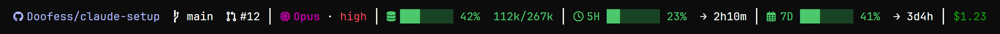
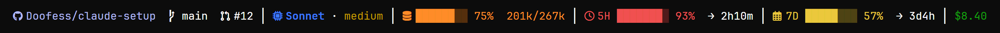
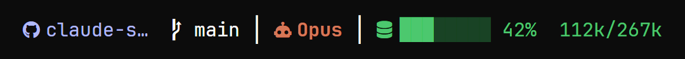
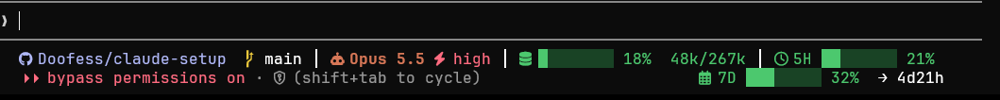
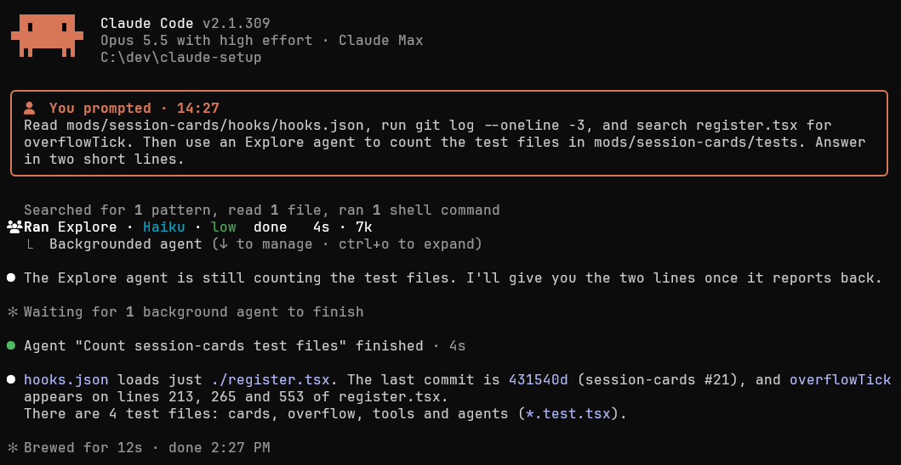

# claude-setup

My Claude Code setup, kept in git so every PC I use looks and behaves the same. One script, `install.ps1`, sets up a fresh
Windows machine: global rules, agents, plugins, a custom status bar, a mod that tidies the conversation view, and the
terminal's font and colours.



## What you see

### The status bar

The line along the bottom of Claude Code, read left to right:

- **Where you are**: the repo (GitHub in violet, GitLab in its orange with its own icon, read from the origin remote) and the branch (Claude Code shows the PR badge itself).
- **Who is working**: the model and the effort level. Each model and each effort level has its own colour, so you can
  tell at a glance whether you're on Opus (Claude orange) or Sonnet, at high or medium. Fable's name is a gold gradient, and a running Fable subagent's row pulses.
- **How full the context is**: a meter that reaches 100% at the auto-compact point (about 267k of the 300k window), not
  at the end of the window. When it's full, it's time to `/clear`.
- **How much plan is left**: the 5-hour and 7-day usage meters, each with the time until it resets.
- **What the session has cost**, in green.
- **How long the session has run**, beside a clock, both in the repo name's violet.

The meters change colour as they fill: green below 50%, yellow from 50%, orange from 70% and red from 90%. The same
session late in a busy day:



When the window is narrow, the least important pieces drop first: session time, cost, then reset times and
the plan meters. Repo, branch, model with its effort, and context always stay; on a very narrow window the repo loses its owner, then
letters of its name. Once the line fits, any dropped piece that still fits comes back, so
no room is wasted:



Dropped pieces aren't lost. The session-cards mod (below) moves them onto Claude Code's hint line, beside the
permissions text:

- A reset time whose meter stays on the top row sits right under the meter's first block, without its `→`.
- A meter that moves takes its reset time with it (`7D ████ 32%  → 4d21h`), its first block under the last meter
  left on the top row. Where it can't line up, it goes to the right.
- The rest (cost, session time) is right-aligned at the margin, or, when a moved meter holds the margin, in the
  free space before it.
- Where pieces collide, the least important one drops, in the bar's own order; the hint always stays.
- While background work shows on the hint line (`1 shell`, monitors, agents), Claude Code's own line stays, so those
  pills stay clickable and open the exact command. The pieces follow it dim, packed left after a ` · `, a meter as
  its percentage alone, since dim blocks can't show how full it is.



The icons come from a Nerd Font. On a machine without one, the installer switches the bar to short words instead
(`ctx`, `5H`, `7D`), so it reads fine in any monospace font. To see the bar without starting Claude Code, run
`python statusbar.py --demo`.

### Session cards

`mods/session-cards` is a Claude Code mod that makes a long session easier to scan:

- **Your prompts** become a coloured card headed with the time you sent them, so you can find your own messages again.
- **Slash-command output** gets a violet card of its own.
- **The end of each turn** is a coloured line with how long it took and when it finished (`✻ Baked for 1s · done 4:20 PM`).
  While a background shell or agent still runs, Claude Code's own line stays, since only it knows when they end.
- **Tool calls** shrink to one short row each: an icon and a few words. Runs of reads, searches and shell commands
  keep Claude Code's own one-line summary ("Searched for 1 pattern, read 1 file…"), as in the picture below.
- **Agents** get a row showing the agent type, its model and effort (in the same colours as the status bar), what it's
  doing right now, how long it has been running and how many tokens it has used.



### Behind the scenes

Nothing to look at here, but it shapes every session:

- **`global/CLAUDE.md`**: global rules for how Claude plans, delegates, verifies and uses git.
- **Two agents**: `Explore` (Haiku, read-only search, replaces the built-in one) and `worker` (Sonnet at medium effort,
  for implementation briefs).
- **Plugins and connectors**: a short always-on list, with everything project-specific kept per project (see
  [Plugin and MCP policy](#plugin-and-mcp-policy)).
- **`advisor-switch`**: turns Claude Code's advisor on (Opus, or Fable when Opus is stuck) and off for one project, in
  its `.claude/settings.local.json`. Claude runs it itself before and after a plan with workers; the installer removes a
  user-level `advisorModel`, so the advisor is never on in every project at once.
- **`codex`**: hands a task to OpenAI's Codex CLI in the background (`codex exec`, read-only unless it works in a
  worktree), on the OpenAI subscription: questions about Codex, independent research, second opinions. Its sibling
  setup is [codex-setup](https://github.com/Doofess/codex-setup).
- **`underwater-photoshop`**: a personal skill that edits underwater and macro photos in the local Photoshop.

## Set up a new machine (Windows)

1. Install [Claude Code](https://code.claude.com), [Git for Windows](https://git-scm.com) (it brings Git Bash),
   [GitHub CLI](https://cli.github.com), [Node](https://nodejs.org) 26+ and [Python](https://python.org) 3.10+. With winget:

   ```powershell
   winget install Anthropic.ClaudeCode Git.Git GitHub.cli OpenJS.NodeJS Python.Python.3.14
   npm i -g pnpm
   winget install --id astral-sh.ruff -e
   ```

   Then run `npm install` at the repo root (installs the pinned Biome for the mod lint hook).

2. Run `claude` once and sign in, then `gh auth login`.
3. Clone and install:

   ```powershell
   git clone https://github.com/Doofess/claude-setup C:\dev\claude-setup
   cd C:\dev\claude-setup
   .\install.cmd
   ```

   `install.cmd` runs `install.ps1` under PowerShell 7 when it is installed, else Windows PowerShell, past 5.1's
   blocked-scripts policy. From Git Bash, run `./install.sh`, which calls it.

4. Restart Claude Code and open a new terminal tab.
5. Only for photo work: `python -m venv ~/.claude/skills/underwater-photoshop/.venv`, then
   `pip install -r skills/underwater-photoshop/requirements.txt` into it. Needs Photoshop 2026 (COM `Photoshop.Application`).

The installer installs JetBrainsMono Nerd Font through winget if the machine has no Nerd Font, sets Windows Terminal's
font and colour scheme, and removes hooks this repo has retired. Options:

| Flag | Effect |
| --- | --- |
| `-KeepFont` | keep the machine's own terminal font |
| `-KeepScheme` | keep the machine's own colour scheme |
| `-SkipFont` | skip the font install and the font change |
| `-SkipPlugins` | skip installing and updating plugins (faster when only config changed) |

It backs up the previous files to `~/.claude/backups/claude-setup-<timestamp>/` on every run.

### Check a machine

After installing, or on a new PC, run `/setup-check` in Claude Code. It finds the clone through
`~/.claude/claude-setup-state.json`, checks the clone is up to date, runs `shell_matrix.py` to compare every shell,
repairs any difference with `install.cmd`, and runs the matrix again. It is done when the matrix exits 0. It asks
before pulling, and it never edits the repo. What the installer can't do (a group-policy pin, a shell winget couldn't
install, signing in to `claude` and `gh`) it hands to you with the exact command.

### Same screen on every PC

After installing, the installer prints a `Same experience` table (`name  expected  actual  ok|FAIL`) and fails if any
row is wrong. It checks everything that decides what the screen looks like: the Nerd Font and Windows Terminal's font
face and `cellHeight`, the `Campbell` colour scheme, Claude Code's theme (`custom:clear` with its file), the status line command, the
session-cards mod being loaded, and Claude Code 2.1.308+, Python 3.10+ and Git Bash. The shell rows cover the rest:
`Terminal profile overrides` (no profile sets its own font or colour scheme; `-KeepFont` / `-SkipFont` excuse font overrides and `-KeepScheme` colour scheme ones, and the row shows `kept`), `Terminal default profile` (PowerShell 7),
`Git Bash profile` (present in Windows Terminal), `PowerShell 7` (pwsh found), `Windows PowerShell policy`
(RemoteSigned or looser; a group-policy pin that is stricter is a FAIL and named), `PowerShell profiles` (the
claude-setup block in both profile files) and `VS Code terminal` (font, Campbell colours and contrast set; `no VS Code`
shows `kept`). These rows only read, so they run under `-Check` too. It also runs the status bar on
sample data and prints it, so a broken bar or a mangled meter glyph stops the install. Rows covered by `-KeepFont`,
`-KeepScheme` or `-SkipFont` show `kept`.
The install records the keep flags it ran with in `~/.claude/claude-setup-state.json` (`flags`); `/setup-check` and
`shell_matrix.py` pass them to the check and the repair, so a font or scheme you kept is never overwritten.

## Changing something

Edit the files here, run `.\install.ps1`, commit and push. On the other machine: `git pull`, then `.\install.ps1`.

From Claude Code's `!` prompt (Git Bash, so use forward slashes):

```bash
git -C C:/dev/claude-setup pull && powershell -ExecutionPolicy Bypass -File C:/dev/claude-setup/install.ps1
```

## Daily habits

- `/clear` when the context meter nears 100% (the auto-compact point), or when `/context` shows usage near 267k.
- `/usage` weekly; `/context` when a session feels heavy; `/skill-doctor` monthly to spot skills that load but never run.
- Start sessions from the repo folder, not `C:\Windows\System32`. Windows Terminal opens in `C:\dev`, and the
  PowerShell 7 profile moves a shell started in System32 (Start menu, taskbar) to `C:\dev`.

## Reference

### What goes where

| In this repo | On the machine |
| --- | --- |
| `global/CLAUDE.md` | `~/.claude/CLAUDE.md` |
| `settings.json` | merged into `~/.claude/settings.json` (plugins, model and effort, skill overrides; see the merge rules below) |
| `agents/*.md` | `~/.claude/agents/` |
| `themes/*.json` | `~/.claude/themes/`; `custom:clear` is Claude Code's `dark` with `userMessageBackground` set to Campbell's background `#0c0c0c`, so the sticky prompt line at the top (the last prompt, once it scrolls away) has no grey bar, and `background` set to Campbell's bright white `#F2F2F2`, so background work (the `1 shell` pill under the prompt, the background-tasks dialog) is white instead of cyan. A typed `/command`'s echo row and the selected row in the background-tasks list lose their grey too. Its text stays the dim `subtle` grey and it has no border: Claude Code draws that one-row line itself, with no mod hook |
| `statusbar.py` | `~/.claude/statusbar.py`, run by `statusLine` in `settings.json` every 60 s so the reset countdowns move |
| `skills/<name>/` | `~/.claude/skills/<name>/` |
| `mods/session-cards/` | stays in the repo; `install.ps1` adds its folder to `CLAUDE_CODE_PLUGIN_DIRS` in `~/.claude/settings.json` and checks it with `claude plugin validate` |
| `terminal/profile.json` | not copied; its font and `colorScheme` are written into Windows Terminal's `profiles.defaults`, and a `colorScheme` on the default profile itself is removed (see [`terminal/README.md`](terminal/README.md)) |
| `mcp_off.py` | not copied; the installer runs it to turn the claude.ai Adobe connector off in each known project in `~/.claude.json` |
| `mcp-presets/` | not installed; copy one into a repo as `.mcp.json` (see [its README](mcp-presets/README.md)) |

Not versioned on purpose: `~/.claude.json` (login state, user-scope MCP servers), `.credentials.json`, `history.jsonl`,
`~/.remember/`. Synced plugins and claude.ai connectors follow the account, so they need no setup here.

### Status bar details

- The context meter's end is the auto-compact window minus 33k: 13k that Claude Code keeps free plus 20k reserved for the reply.
- Each meter has 8 cells: the filled part in the bright level colour, the rest in a dark shade of the same colour; its
  icon and numbers take that colour too.
- Separators, the other icons, the branch name and reset times are sent as exact white rather than the terminal's
  default foreground (light grey in most schemes), so nothing on the line is grey. The branch icon is the meters' yellow.
- Effort runs green, yellow, the bypass red, then xhigh and max as the `/effort` picker draws them, held still: xhigh in
  the violet of `accept edits` with its middle letter lit, max a rainbow that starts at the bolt.
- The pieces dropped on a narrow terminal are written to `~/.claude/statusbar-overflow/<session_id>.json`, as text with
  their colours, with where each one goes and the width of the mode label in front of the hint (read from the session
  transcript); files older than a day are removed. The session-cards mod reads them for the hint line. Beside the
  plain hints (`? for shortcuts`, `(shift+tab to cycle)`) it draws the line itself; beside any other hint, such as the
  `1 shell` pill, it hands the pieces to Claude Code's `tail`, since a rewritten hint turns the pills into dead text.
- Reset times and the session time leave out a zero hour count past a day: `5d`, not `5d0h`.
- Most of the bar's and the mod's colours are the colour scheme's own 16; Claude orange, the repo's violet and high
  effort's red (the red of `bypass permissions on`) are Claude Code's exact theme colours. The icons depend on the Nerd
  Font's glyph widths, so a different scheme or font gives a different screen.

### Settings merge rules

`settings.json` is merged into the machine's `~/.claude/settings.json`: `enabledPlugins` and `env` entry by entry (the
repo wins a conflict, the machine's other entries stay), `permissions` with arrays unioned, `hooks` per event and per
command, and every other key replaced by the repo's value. A key removed from the repo stays on the machine, so retiring
one needs an explicit step in `install.ps1`.

`env.CLAUDE_CODE_PLUGIN_DIRS` (`;`-separated) is the one `env` entry that is unioned rather than replaced: the
machine's own folders stay, ours (`<repo>/mods/session-cards`, with `<repo>` being this clone in forward slashes) is
added once, and an existing entry ending in `/mods/session-cards` (from an older clone or worktree) is replaced by it.
Entries are compared ignoring slash style, trailing slash and case.

### Plugin and MCP policy

- Always on (user scope): superpowers, frontend-design, context7, playwright, and the typescript, pyright and
  rust-analyzer LSPs. claude-md-management and the synced design and engineering plugins are pinned off. The synced
  docs/docx/pdf/pptx/xlsx skills and the browser and computer-use skills load by name only (`skillOverrides`).
- Superpowers' brainstorming, diagnosing-superpowers, dispatching-parallel-agents, receiving-code-review,
  requesting-code-review, verification-before-completion and writing-skills are off (`skillOverrides`): CLAUDE.md asks
  design questions through `AskUserQuestion`, reviews with the built-in `/code-review`, and keeps "run the check before
  saying done" as a rule of its own. `good-css` is declared in `extraKnownMarketplaces`
  (`vojtaholik/good-css`); enabling it is left to each machine.
- Anything tied to one project (databases, deploy target, observability, Kubernetes) is project scope: `mcp-presets/`.
- The GitHub MCP server stays off; `gh` does the same job with far less context.
- `deniedMcpServers` blocks every claude.ai connector except Adobe, Supabase and Cloudflare (Slack, Linear, Atlassian,
  Notion, Figma, Intercom, Claude Docs, Vercel, Canva, Spotify, Google Docs/Sheets/Calendar/Drive, Gmail, and
  desktop-commander). BigQuery is retired; the installer removes its user-scope server and hook.
- Adobe: the "Adobe for creativity" claude.ai connector is the only route to Adobe tools from the CLI (the plugin copies
  return 403). It costs about 5k tokens a turn, so the installer turns it off in each project it knows (`mcp_off.py`);
  `/mcp` turns it back on for one project, and that choice survives re-runs. A deny-list entry wouldn't work here: deny
  lists union across settings sources, so `--settings` can't lift one for a session. A project first opened after the
  last install starts with Adobe on. Photo edits themselves run in local Photoshop via the `underwater-photoshop` skill.

## History

The first visual setup (a custom theme, the readable-session mod, a Windows Terminal "Readable" scheme and an older
status line) was retired on 2026-10-23 and rebuilt as the status bar and session-cards mod above. Tag `visual-v1` holds
the old version, and the installer removes it from machines that still have it.
