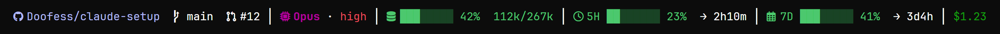

# claude-setup

A coding-agent setup kept as code: one installer makes every Windows PC look and behave the same, on top of Claude Code's own defaults: no plugins, agents, hooks, MCP servers or language servers.



## What is in it

- `install.ps1`: one re-runnable command for all of it, plus the terminal's font and colours. The first run on a PC resets it to a clean slate (below).
- `statusbar.py`: the line in the picture.
- `mods/session-cards`: a Claude Code mod that restyles the conversation view.
- `themes/clear.json`: the Claude Code theme.
- `skills/`: `pre-merge-review` (a pull request review procedure and `gate.py`), `advisor-switch` and `setup-check`.
- `shell_matrix.py`: checks that four Windows shells end up the same.

Setting up a new PC in full and daily use: [docs/manual.md](docs/manual.md).

## The engineered parts

The settings template sets `bypassPermissions` and turns off its warning, so Claude Code runs commands without asking, and `remoteControlAtStartup`, so every session can be driven from claude.ai or the phone. Besides those it holds only the look (status line, theme, session-cards mod) and preferences (model, fullscreen `tui`, `editorMode`, auto-compact window, update channel and a few others); every other setting is Claude Code's default.

### Clean slate

`install.ps1` resets a PC once (the `cleanSlate` key in `~/.claude/claude-setup-state.json`, written only when nothing failed; after a failure the next run repeats only the failed steps): it uninstalls every user-scope plugin and every marketplace but `claude-plugins-official`, deletes `~/.claude/agents/*` and `~/.claude/CLAUDE.md`, removes the Kotlin language server and its Path entry, drops two toggles from `~/.claude.json`, and writes `~/.claude/settings.json` fresh from the template. Plugins installed at project scope are listed with the command to run in their project. The run's backup holds the agents, the global CLAUDE.md, `settings.json`, `~/.claude.json`, the state file and the plugin and marketplace records first; the plugins themselves, the retired skill folders, `~/.claude/photo-edit` and the Kotlin server are not backed up. The reset is functions with the `claude` CLI and every path as parameters, tested against a fake CLI, a scratch folder and a scratch registry key under both PowerShell engines.

### Pre-merge review gate

`skills/pre-merge-review/gate.py` (standard-library Python) is a `PreToolUse` hook script that refuses `gh pr merge` until `gate.py record` has stored a review for the PR's current head commit, and the merge must pass that commit as `--match-head-commit`. It also refuses `git push` while the branch's PR has auto-merge on. The installer no longer registers it: the template has no hooks, so the merge flow relies on the `pre-merge-review` skill alone until a project adds `python -I -S ~/.claude/skills/pre-merge-review/gate.py check; exit 0` as a `PreToolUse` hook on `Bash|PowerShell`. `tests/test_pre_merge.py` runs the gate as a subprocess against a fake `gh` (quoting, `cd` tracking, records) and covers crashes, the time budget and pattern timing.

### Settings merge

After the first run the installer merges into each machine's own settings: `env` entry by entry (`CLAUDE_CODE_PLUGIN_DIRS` unioned), `permissions` arrays unioned, everything else replaced. The helpers are pure functions, tested under PowerShell 5.1 and 7 for identical output. A hand-written JSONC editor changes Windows Terminal's settings without losing the user's comments (9 test fixtures), and a second run leaves the file unchanged.

### Status bar

Claude Code runs `statusbar.py` every 60 s: session JSON in, one line out. The context meter reaches 100% at the auto-compact point. On a narrow terminal the least important pieces drop, any that still fit come back, and the dropped ones go through a per-session file to the mod, which draws them on the hint line. `tests/test_statusbar.py` has 83 cases, from layout at several widths to remote URL parsing.

### Session-cards mod

`register.tsx` (1,109 lines of TypeScript) uses Claude Code's mod API for prompt cards, one-row tool calls and agent rows with model, effort, time and tokens. Its 91 cases in 5 files cover those rows and the hint-line placement.

## Testing

Python `unittest` files under `tests/`, and the mod's own test files. `unittest` reports more tests than there are methods, because the installer-helper tests (and the 5.1 parse check) run once under each PowerShell engine. The installer tests check its functions and source text; two opt-in tests run `-Check` on the real machine. There is no CI.

```powershell
python -m unittest discover -s tests -q
claude plugin test mods/session-cards
```

## Install

Windows only, built for its owner's PCs. It also changes Windows Terminal, VS Code's terminal, PowerShell profiles and the execution policy. It backs up the Claude Code and Terminal settings first; `-Check` changes nothing. A PC that still has the old setup (plugins, agents, a global `CLAUDE.md`, the Kotlin language server) is reset once on the first run.

```powershell
winget install Anthropic.ClaudeCode Git.Git GitHub.cli OpenJS.NodeJS Python.Python.3.14
claude            # sign in once, then exit
gh auth login
git clone https://github.com/Doofess/claude-setup C:\dev\claude-setup
cd C:\dev\claude-setup
.\install.cmd -Check
.\install.cmd
```

## Status

In daily use. Windows only, no releases, no CI.

## License

MIT. See [LICENSE](LICENSE).
